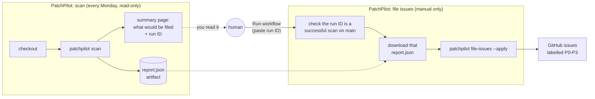

# PatchPilot

[](https://github.com/SidVelagapalli/patchpilot/actions/workflows/tests.yml)
[](LICENSE)

**A scheduled GitHub Action that finds known vulnerabilities in your dependencies and ranks the ones attackers are
actively exploiting first, then files issues only after a human clicks Run.**

New to this? Read **[How it works, in plain English](docs/HOW-IT-WORKS.md)** first.

It reads the versions you pin (`requirements.txt`, `package-lock.json`, CDN `<script>` tags in HTML), checks each one
against [OSV.dev](https://osv.dev), ranks anything on CISA's
[Known Exploited Vulnerabilities](https://www.cisa.gov/known-exploited-vulnerabilities-catalog) list as **P0**, and
shows you what it *would* file. Nothing is written to your repo until you approve it. Built for a small private
e-commerce site (`shraddha-store`); its first live run there is still pending.

## How it works



| Workflow | Trigger | Permissions | Does |
|---|---|---|---|
| [`patchpilot-scan.yml`](examples/patchpilot-scan.yml) | schedule + manual | `contents: read` | scan, upload `report.json`, write a dry run to the run's summary page |
| [`patchpilot-file-issues.yml`](examples/patchpilot-file-issues.yml) | manual only | `permissions: {}` at the top; the job gets `actions: read` + `issues: write` | verify the run ID, download that report, create issues (skips any advisory that already has an open PatchPilot issue) |

## Example output

Real dry run on Nov 6, 2026 against a project pinning `lodash 4.17.15` (`/tmp/demo/package-lock.json`). Each
`would file` line is followed by that issue's body; the bodies are left out here and one is shown below.

```
$ patchpilot scan --path /tmp/demo --out /tmp/demo/report.json
1 dependencies, 5 findings {'P1': 3, 'P2': 2} -> /tmp/demo/report.json

$ patchpilot file-issues --report /tmp/demo/report.json --repo you/your-repo     # no --apply = dry run
--- would file: `[P1] GHSA-35jh-r3h4-6jhm in lodash@4.17.15`
--- would file: `[P1] GHSA-p6mc-m468-83gw in lodash@4.17.15`
--- would file: `[P1] GHSA-r5fr-rjxr-66jc in lodash@4.17.15`
--- would file: `[P2] GHSA-29mw-wpgm-hmr9 in lodash@4.17.15`
--- would file: `[P2] GHSA-xxjr-mmjv-4gpg in lodash@4.17.15`
dry run: 5 issue(s)
```

One issue body, exactly as it would be filed:

````markdown
```text
lodash 4.17.15 is affected by GHSA-35jh-r3h4-6jhm: Command Injection in lodash Severity: HIGH. Upgrade to 4.17.21.
```

- **Package:** `lodash` `4.17.15` (npm), found in `package-lock.json`
- **Advisory:** [GHSA-35jh-r3h4-6jhm](https://osv.dev/vulnerability/GHSA-35jh-r3h4-6jhm) `CVE-2021-23337`
- **Known exploited (CISA KEV):** no
- **Fixed in:** `4.17.21`

_Filed by PatchPilot after human approval._
````

## Design decisions

- **Known-exploited beats severity.** A LOW-severity bug that CISA has seen exploited in the wild is P0; a HIGH one
  that nobody is exploiting is P1. Severity says how bad a bug *could* be; KEV says someone is using it *today*.
  See [`priority()`](src/patchpilot/intel.py).
- **A human gate that works on a private repo.** The obvious design is a GitHub Environment with required reviewers,
  but on the Free plan those only work for public repos, and the repo this guards is private. So filing lives in its
  own `workflow_dispatch`-only workflow: you read the scan's summary page, then click Run and paste that run's ID.
  The workflow refuses any run ID that isn't a successful scan run on the default branch, so a pull request's workflow
  can't hand it a forged report.
- **Least privilege per job.** The scan can't write anything. The filing job has no checkout, so no repo code runs
  next to the write token. Actions are pinned to commit SHAs, and PatchPilot itself is installed from a pinned commit.
- **Advisory text is untrusted.** Summaries come from public databases (and optionally an LLM), so they go inside a
  code block whose fence is longer than any run of backticks in the text: GitHub renders no `@mentions`, HTML or
  links there. The package, version, file path, CVE and fixed-in fields are shown as inline code only if they pass an
  allowlist; anything else is hidden.
- **Free by default.** Summaries use a template. `--llm` (with `--apply`, `ANTHROPIC_API_KEY`, and `PATCHPILOT_MODEL` set
  to an Anthropic model ID) switches to LLM summaries via the Anthropic API; a key sitting in your environment is never
  enough to spend money, and dry runs never call it.
- **Fail loud.** A broken lockfile is skipped with a warning in the report; an OSV outage stops the scan with a
  one-line error; if GitHub refuses an issue halfway, the run stops and lists what was already filed (re-running is
  safe because open issues are skipped).

## Run it locally (free)

```
git clone https://github.com/SidVelagapalli/patchpilot && cd patchpilot
uv run pytest -q                                                    # 32 offline tests, no network
uv run patchpilot scan --path /path/to/your/project --out report.json
uv run patchpilot file-issues --report report.json --repo you/your-repo   # dry run: prints, files nothing
```
The scan calls OSV.dev and the CISA KEV feed (both free, no key). Nothing calls a paid API unless you pass `--llm --apply`.

**Use it on your repo:** copy both files in [`examples/`](examples/) into your repo's `.github/workflows/`, and replace
`REPLACE_WITH_PATCHPILOT_COMMIT_SHA` in each with the PatchPilot commit you reviewed (the install fails until you do).
Each Monday: open the scan run, read its summary, then Actions -> "PatchPilot: file issues" -> Run workflow -> paste the run ID.

## Limitations

- Only exact pins are checked (`name==1.2.3`, lockfile versions, `lib@1.2.3` in CDN URLs). Ranges like `requests>=2`
  have no single version to look up.
- One issue per advisory id: if two packages share an advisory, the second is skipped. Dedupe reads open issues only,
  so closing an issue without upgrading means it is filed again next week.
- The gate trusts people with write access: a collaborator could pass the run-ID check with a tag named like the
  default branch, or dispatch a modified workflow from their own branch. (They could also file issues by hand.)
- Files skipped as broken show up in the scan log but not yet on the summary page you read before clicking Run, and a
  scan of a folder that doesn't exist reports "0 dependencies" instead of failing.
- Without the `packaging` library, versions are compared by their numbers only, which can rank `1.0.0-rc1` above `1.0.0`.
- PatchPilot's own Python dependencies are not hash-pinned in the filing job yet.
- The example workflows have not yet been run end to end on GitHub.

## Tech stack

Python 3.11+, [httpx](https://www.python-httpx.org/), OSV.dev API, CISA KEV feed, GitHub REST API, GitHub Actions,
pytest (with `httpx.MockTransport` for offline GitHub tests), uv. Opt-in, paid: LLM summaries via the Anthropic API (set `PATCHPILOT_MODEL` to an Anthropic model ID).

## License

[MIT](LICENSE)
