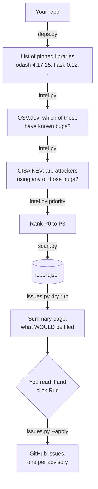

# How PatchPilot works (plain English)

PatchPilot is a scheduled GitHub Action that finds known vulnerabilities in your dependencies and ranks the ones
attackers are actively exploiting first, then files issues only after a human clicks Run.

## The problem

Almost every app is built on other people's code: libraries. A shop website might load `lodash` from a CDN, or a
Python app might use `flask`. You pin a version (say `lodash 4.17.15`) and forget about it.

Later, someone finds a security bug in that version. It gets a public ID (like `GHSA-35jh-r3h4-6jhm` or
`CVE-2021-23337`) and a fixed version (`4.17.21`). Your app is now vulnerable, and nothing tells you.

Most such bugs are never actually used by attackers. A short list *is*: the US cybersecurity agency CISA keeps a
**Known Exploited Vulnerabilities (KEV)** list of bugs it has seen attacked in the real world. Those are the ones to
fix first.

PatchPilot checks your pinned libraries every week, ranks what it finds, and opens a GitHub issue for each problem,
but **only after a person has looked at the list and clicked Run**.

## The flow



1. **Find the libraries** (`deps.py`). Walk the repo and read three kinds of file: `requirements.txt` (Python),
   `package-lock.json` (JavaScript) and HTML pages that load libraries from a CDN. Keep only exact versions:
   `flask==0.12` counts, `requests>=2` doesn't (there's no single version to check).
2. **Ask OSV.dev** (`intel.py`). OSV is a free public database of open-source vulnerabilities. One request asks about
   every library at once and gets back advisory IDs.
3. **Ask CISA KEV** (`intel.py`). Download the KEV list and check whether any advisory's CVE number is on it.
4. **Rank** (`priority()` in `intel.py`):
   - **P0**: on the KEV list. Someone is attacking this today, whatever its severity.
   - **P1**: severity HIGH or CRITICAL.
   - **P2**: MODERATE or MEDIUM.
   - **P3**: anything else, including "severity unknown".
5. **Write a report** (`scan.py`). Everything goes into `report.json`. This step only reads; it changes nothing.
6. **Show what would be filed** (`issues.py`, dry run). The scan workflow prints every issue it *would* create onto
   the GitHub Actions summary page, plus the run's ID.
7. **You decide.** You read that page. If it looks right, you open the second workflow, click **Run workflow**, and
   paste the run ID.
8. **File the issues** (`issues.py --apply`). Only now does anything get written: one issue per advisory, labelled
   with its priority, skipping any advisory that already has an open PatchPilot issue.

## What each file does

| File | What it does |
|---|---|
| `src/patchpilot/deps.py` | Finds pinned libraries in a repo (requirements.txt, package-lock.json, CDN tags in HTML). Skips symlinks and broken files, and records a warning for each broken one. |
| `src/patchpilot/intel.py` | Talks to OSV.dev and the CISA KEV feed, works out which version fixes each bug (comparing versions as numbers, so 4.17.21 > 4.17.9), and ranks P0-P3. |
| `src/patchpilot/scan.py` | Glues the first half together: libraries -> advisories -> KEV -> ranked findings -> `report.json`. Read-only. |
| `src/patchpilot/summarize.py` | Turns a finding into a short summary. A free template by default; an LLM via the Anthropic API only with `--llm --apply` (set `PATCHPILOT_MODEL` to an Anthropic model ID). |
| `src/patchpilot/issues.py` | Builds each issue's title and body safely, skips advisories that already have an open issue, and creates issues (only with `--apply`). |
| `src/patchpilot/cli.py` | The `patchpilot` command: `scan` and `file-issues`. If the vulnerability databases are down during a scan, it prints one clear line instead of a crash dump. |
| `examples/patchpilot-scan.yml` | The weekly GitHub Action: scan, upload the report, show the dry run. Can't write anything. |
| `examples/patchpilot-file-issues.yml` | The manual GitHub Action: check the run ID, download that report, file the issues. |

## The safety decisions, and why

- **A person approves before anything is written.** An automated tool that opens issues on its own can spam a repo
  or be tricked. GitHub's usual tool for this, an "environment" with required reviewers, only works on *public*
  repos on the free plan, and the repo this protects is private. So filing is a separate workflow that runs only when
  you click Run. It first checks that the run ID you pasted really is a successful PatchPilot scan on your main
  branch, so a pull request can't sneak in a fake report.
- **Each step gets only the permissions it needs.** The scan can only read. The filing step can write issues but
  never checks out your code, so nothing from the repo runs next to the token that can write.
- **Advisory text is treated as untrusted.** The bug descriptions come from public databases that anyone can
  contribute to. If PatchPilot pasted them into an issue as-is, a description containing `@someone` would notify
  that person, and HTML or links could disguise the issue. So the description goes inside a code block, where GitHub
  shows text literally. The block's fence is made longer than any run of backticks in the text, so the text can't
  close the block early. Shorter fields (package, version, file path, CVE IDs) are shown as code only if they
  contain ordinary characters; anything else is replaced with "(hidden: unexpected characters)".
- **Symlinks are never followed.** A repo PatchPilot scans could contain a link pointing anywhere on the machine,
  for example at a system file or at `/dev/zero`, which never ends. So links (files and folders) are skipped.
- **One broken file doesn't stop the scan.** A half-written `package-lock.json` is skipped with a warning in the
  report, and every other file is still checked.
- **Failures are loud.** If OSV is down, the scan stops with a one-line error and writes nothing. If GitHub refuses
  an issue halfway through, the run stops and lists what it already filed. Running it again is safe because open
  issues are skipped.
- **Free by default.** Summaries use a template. The LLM is only used if you ask for it on a real run, never on a
  dry run, and never just because an API key happens to be set.

## Example output

A project pinning `lodash 4.17.15`, scanned on Nov 6, 2026:

```
$ patchpilot scan --path /tmp/demo --out /tmp/demo/report.json
1 dependencies, 5 findings {'P1': 3, 'P2': 2} -> /tmp/demo/report.json

$ patchpilot file-issues --report /tmp/demo/report.json --repo you/your-repo
--- would file: `[P1] GHSA-35jh-r3h4-6jhm in lodash@4.17.15`
...
dry run: 5 issue(s)
```

None of the five is on the KEV list, so nothing is P0. The first issue's body:

````markdown
```text
lodash 4.17.15 is affected by GHSA-35jh-r3h4-6jhm: Command Injection in lodash Severity: HIGH. Upgrade to 4.17.21.
```

- **Package:** `lodash` `4.17.15` (npm), found in `package-lock.json`
- **Advisory:** [GHSA-35jh-r3h4-6jhm](https://osv.dev/vulnerability/GHSA-35jh-r3h4-6jhm) `CVE-2021-23337`
- **Known exploited (CISA KEV):** no
- **Fixed in:** `4.17.21`

_Filed by PatchPilot after human approval._
````

## Limitations

- **Exact versions only.** Ranges like `requests>=2` aren't checked.
- **"Severity unknown" becomes P3.** Some advisories (many Python ones) only give a CVSS score, which PatchPilot
  doesn't read yet, so a serious bug could be ranked P3 unless it's on the KEV list.
- **Skipped files only show up in the scan log, not on the summary page.** A broken `package-lock.json` is skipped
  with a warning, but the page you read before clicking Run doesn't mention it yet.
- **A wrong folder looks like a clean repo.** Scanning a folder that doesn't exist reports "0 dependencies, 0
  findings" instead of an error.
- **Version ranking may differ in Actions.** Without the `packaging` library installed, a fallback compares versions
  by their numbers only, which can rank a release candidate (`1.0.0-rc1`) above the release.
- **One issue per advisory.** If two libraries share an advisory, only the first gets an issue. Closed issues are
  filed again the next week.
- **The gate trusts collaborators.** Someone with write access could get around the run-ID check. They could also
  just file issues by hand.
- **Not yet run live.** The two example workflows haven't been run end to end on GitHub.
